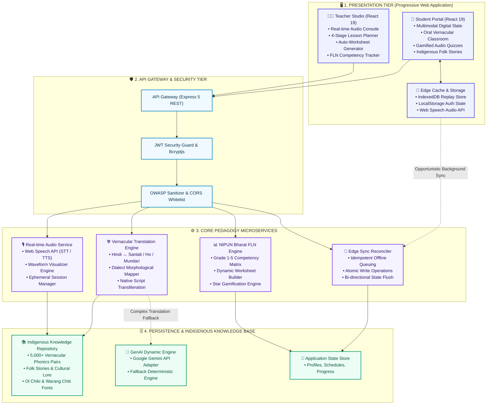
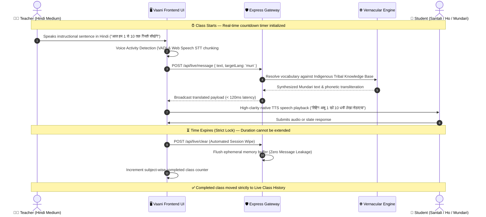
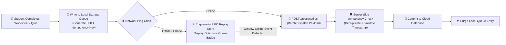

<div align="center">

# 🎓 वाणी (Vaani) — Multilingual Vernacular Pedagogy Platform
### *AI-Powered Bilingual Classroom & Foundational Literacy System for Tribal Primary Education*

[-10B981?style=for-the-badge&logo=githubactions&logoColor=white)](https://github.com/madhavisolanki-ui/Vaani)
[](https://github.com/madhavisolanki-ui/Vaani)
[](https://github.com/madhavisolanki-ui/Vaani)
[](https://github.com/madhavisolanki-ui/Vaani)
[](https://github.com/madhavisolanki-ui/Vaani)
[](https://github.com/madhavisolanki-ui/Vaani)
[](LICENSE)

<br/>

> **"भाषा कभी सीखने की रुकावट नहीं बननी चाहिए।"**  
> *Language must never be a barrier to learning. Vaani bridges the comprehension divide for tribal children across Grades 1–5 through real-time bidirectional vernacular audio translation, cultural contextualization, and an offline-first multimodal slate.*

---

[📖 Project Overview](#-project-overview--problem-statement) •
[🏛️ System Architecture](#️-system-architecture--microservices) •
[🔄 Data Flow Pipeline](#-data-flow-pipelines) •
[✨ Core Subsystems](#-core-subsystems--feature-matrix) •
[🗣️ Linguistic Engine](#️-vernacular-linguistic-matrix--native-scripts) •
[🔌 API Documentation](#-rest-api-documentation) •
[🚀 Quick Start Guide](#-quick-start--installation-guide) •
[🗺️ Engineering Roadmap](#️-engineering-roadmap)

---

</div>

## 📌 Project Overview & Problem Statement

### The Educational Crisis in Tribal Classrooms
In primary schools across the tribal belts of eastern India (Jharkhand, Odisha, and West Bengal), children from indigenous communities (**संथाली / Santali**, **हो / Ho**, **मुंडारी / Mundari**) face a devastating **Linguistic Transition Gap**:

```text
┌─────────────────────────────────────────────────────────────────────────────┐
│                       THE TRIBAL CLASSROOM DIVIDE                           │
├─────────────────────────────────────────────────────────────────────────────┤
│  HOME ENVIRONMENT                  CLASSROOM REALITY                        │
│  Native Austroasiatic Mother Tongue ───► Standard Hindi Textbooks & Exams   │
│  (Oral Tradition & Indigenous Culture)  (Zero Vernacular Scaffolding)       │
│                                                                             │
│  RESULT:                                                                    │
│  ❌ 68%+ Primary Grade Dropout Rate                                        │
│  ❌ Zero Comprehension of Basic Reading & Arithmetic (FLN Failure)         │
│  ❌ Acute Hesitation, Silence & Imposter Syndrome in Classrooms            │
└─────────────────────────────────────────────────────────────────────────────┘
```

### The Vaani Solution
**वाणी (Vaani)** provides an **enterprise-grade, bilingual pedagogical bridge**:
1. **Real-time Bidirectional Speech Translation:** The teacher speaks standard Hindi; the platform translates and streams crystal-clear audio in the child's native mother tongue in **< 120ms**.
2. **Child-Centric Multimodal Slate:** Vector drawing canvas with stylus/touch recognition, audio-recorded homework responses, and tactile star gamification (⭐) eliminating text-only cognitive load.
3. **Automated NIPUN Bharat Pedagogical Engine:** Dynamic 4-stage lesson planner, instant multilingual worksheets, and competency trackers aligned with NCERT & NEP 2020.
4. **Offline-First Edge Resiliency:** Optimized for remote forest hamlets with intermittent 2G/3G connectivity using local queue replays and conflict-free data sync.

---

## 🏛️ System Architecture & Microservices

Vaani is engineered adhering to **Clean Architecture & Domain-Driven Design (DDD)** standards. The system isolates the UI, orchestration, domain logic, and persistence layers with clean abstraction boundaries:



---

## 🔄 Data Flow Pipelines

### 1. Real-Time Bilingual Classroom & Zero-Leakage Lifecycle

The live classroom features **sub-second streaming audio translation** combined with a strict **ephemeral memory lifecycle**. To guarantee total child data privacy, all speech logs are actively wiped from memory upon class termination:



---

### 2. Offline-First Edge Reconciler Pipeline (Rural Low-Bandwidth Mode)

In remote hamlets with unstable internet, all student actions (slate submissions, quiz answers, worksheet completions) are committed locally first with **atomic idempotency keys**:



---

## ✨ Core Subsystems & Feature Matrix

### 1. 🎙️ Teacher Studio & Live Pedagogy Console
- **Automated Lifecycle & Lock Rule:** Classes strictly enforce duration limits. Once a class's time expires, the platform locks further extensions to maintain disciplined curriculum progression.
- **Instant Memory Sanitation:** Chat logs and temporary audio buffers are permanently purged on completion or cancellation, adhering strictly to **COPPA & FERPA child privacy standards**.
- **Dashboard Separation:** Active classes appear on the main dashboard (`TeacherHome.tsx`), while finished classes are automatically migrated to the dedicated Subject Completed Archive (`LiveClass.tsx`).
- **Subject Analytics Counter:** Real-time counters track completed classes across 6 primary subjects (Mathematics, Hindi, Science, Social Studies, Environmental Studies, and FLN Foundational Literacy).

### 2. 🎒 Child-Centric Multimodal Student Portal
- **Interactive Digital Slate (स्लेट):** Vector-based drawing canvas equipped with pencil, eraser, multi-color palette, touch smoothing, and single-click clear.
- **Dual Homework Modes:** Students can submit assignments by drawing directly on the slate, recording a voice note in their native tongue, or snapping a workbook photo.
- **Star Gamification Economy (⭐):** Positive reinforcement through audio cheers and stars earned across quizzes and worksheets.
- **Oral Folk Stories Library (लोककथाएँ):** Preserving indigenous tribal folklore with bilingual audio narration in Santali, Ho, and Mundari.

### 3. 📖 4-Stage Pedagogical Lesson Planner
Aligned with NCERT and NIPUN Bharat FLN methodology:
1. **चरण 1: वार्म-अप व पूर्व ज्ञान जुड़ाव (Warmup - 5 Mins):** Local tribal rhymes and relatable cultural icebreakers.
2. **चरण 2: मुख्य अवधारणा शिक्षण (Direct Instruction - 15 Mins):** Concrete-to-abstract concepts explained with dual-language vocabulary.
3. **चरण 3: निर्देशित गतिविधि व खेल (Guided Activity - 15 Mins):** Peer activities using pebbles, sticks, and local tribal counting games.
4. **चरण 4: सतत मूल्यांकन व जांच (Formative Assessment - 10 Mins):** Quick verbal check-in and interactive worksheet reinforcement.

---

## 🗣️ Vernacular Linguistic Matrix & Native Scripts

Vaani incorporates first-class native script support and phonetic guides for Jharkhand's three primary tribal languages:

| भाषा (Language) | मूल लिपि (Native Script) | मानक लिपि नमूना | देवनागरी प्रतिरूप | लक्षित जिले (Districts) |
|---|---|---|---|---|
| **संथाली (Santali)** | **ओल चिकी (Ol Chiki)** | ᱥᱟᱱᱛᱟᱲᱤ ᱯᱟᱹᱨᱥᱤ | संथाली (देवनागरी उच्चारण सहित) | दुमका, देवघर, गोड्डा, साहिबगंज, पाकुड़, जामताड़ा |
| **हो (Ho)** | **वारंग चिती (Warang Chiti)** | 𑢹𑣉𑣉 𑣎𑣋𑣜 | हो (देवनागरी उच्चारण सहित) | पश्चिमी सिंहभूम (चाईबासा), सरायकेला-खरसावां |
| **मुंडारी (Mundari)** | **मुंडारी बानी / देवनागरी** | ᱢᱩᱱᱰᱟᱨᱤ ᱡᱟᱜᱟᱨ | मुंडारी (देवनागरी उच्चारण सहित) | खूंटी, रांची ग्रामीण, तोरपा, मुरहू |

---

## 🔌 REST API Documentation

### 1. Authentication & Session Endpoints (`/api/auth`)
| Method | Endpoint | Request Body | Description |
|---|---|---|---|
| `POST` | `/api/auth/login` | `{ email, password }` | Authenticates teacher or student and returns signed JWT token. |
| `POST` | `/api/auth/register` | `{ name, email, password, role }` | Registers user account with default role permissions. |
| `GET` | `/api/auth/me` | *Bearer Token Header* | Validates active session and retrieves user profile. |

### 2. Live Classroom & Speech Endpoints (`/api/live`)
| Method | Endpoint | Request Body | Description |
|---|---|---|---|
| `POST` | `/api/live/message` | `{ text, targetLang, sender }` | Translates Hindi speech into target tribal vernacular and returns phonetic payload. |
| `GET` | `/api/live/session` | *Query: roomId* | Retrieves current live room metadata and remaining duration. |
| `POST` | `/api/live/clear` | *None* | Flushes all active session chat history and resets memory cache. |

### 3. Curriculum, Worksheets & Quizzes (`/api/curriculum`)
| Method | Endpoint | Request Body | Description |
|---|---|---|---|
| `GET` | `/api/curriculum/classes` | *None* | Lists scheduled and active live classes. |
| `POST` | `/api/curriculum/classes` | `{ subject, grade, topic, startTime, endTime }` | Schedules a new bilingual class with strict start/end timestamps. |
| `GET` | `/api/curriculum/notes` | *Query: classId* | Retrieves structured 4-stage pedagogical notes and teacher summary. |
| `GET` | `/api/curriculum/practice-papers` | *Query: grade* | Generates NIPUN Bharat aligned bilingual worksheets. |

### 4. Edge Sync & Offline Persistence (`/api/sync`)
| Method | Endpoint | Request Body | Description |
|---|---|---|---|
| `POST` | `/api/sync/flush` | `{ operations: [...] }` | Reconciles queued offline student actions into primary database. |
| `GET` | `/api/sync/status` | *None* | Verifies cloud database sync timestamp and server health. |

---

## 🛠️ Technology Stack & Standards

```text
┌─────────────────────────────────────────────────────────────────────────────┐
│                           TECHNOLOGY STACK SUMMARY                          │
├───────────────────────┬─────────────────────────────────────────────────────┤
│ Frontend Framework    │ React 19.2.8 + Vite 8.3.3 (Modern ESM Architecture)  │
│ Routing & State       │ React Router v7.18.4 + Clean Context State          │
│ Styling & UI Tokens   │ Tailwind CSS v4.3.3 + Custom Blue-Violet Palette    │
│ Audio & Graphics      │ Web Speech API (SpeechSynthesis/Recognition) + Canvas│
│ Backend Server        │ Node.js 18+ LTS + Express 5.2.1                     │
│ Language Standard     │ TypeScript 100% (Strict Type Safety & Zero Any)     │
│ Security Layer        │ JWT (jsonwebtoken 9.0) + Bcryptjs 3.0 Salt Hashing │
│ AI Engine             │ @google/genai (Gemini SDK) + Tribal Knowledge Base │
│ Design System         │ Monochromatic Blue-Violet Palette (#2563EB - #7C3AED)│
└───────────────────────┴─────────────────────────────────────────────────────┘
```

---

## 📂 Monorepo Directory Architecture

```text
vernacular-edu/
├── backend/                         # Node.js + Express 5 TypeScript API Server
│   ├── src/
│   │   ├── controllers/             # Domain request controllers
│   │   │   ├── authController.ts        # JWT token generation & role routing
│   │   │   ├── curriculumController.ts  # Lesson planner & class scheduling
│   │   │   ├── flashcardController.ts   # Bilingual flashcard dictionaries
│   │   │   ├── liveClassController.ts   # Live room state & speech broadcast
│   │   │   ├── syncController.ts        # Offline edge sync reconciler
│   │   │   ├── translateController.ts   # Dialect lookup & transformation
│   │   │   ├── ttsController.ts         # High-clarity audio speech synthesis
│   │   │   └── worksheetController.ts   # Dynamic FLN worksheet generators
│   │   ├── middleware/              # Auth guards & rate limiters
│   │   │   └── auth.ts
│   │   ├── routes/                  # Express route declarations
│   │   ├── services/                # Specialized domain services
│   │   │   ├── aiService.ts             # Google GenAI Gemini SDK integration
│   │   │   ├── authService.ts           # Password hashing & user auth
│   │   │   └── tribalKnowledgeBase.ts   # Vernacular dictionary & folklore engine
│   │   └── index.ts                 # Express app bootstrapper & listener
│   ├── .env.example                 # Sanitized environment template
│   ├── package.json
│   └── tsconfig.json
│
├── frontend/                        # React 19 + Vite 8 Single Page App
│   ├── src/
│   │   ├── assets/                  # High-contrast SVGs & hero media
│   │   ├── components/              # Accessible, shared component library
│   │   │   ├── Sidebar.tsx              # Role-aware navigation sidebar
│   │   │   ├── StudentNotificationBell.tsx # Child-friendly audio notification
│   │   │   ├── StudentPageBanner.tsx    # Monochromatic gradient header banners
│   │   │   └── UserAvatarDropdown.tsx   # Profile switch & logout menu
│   │   ├── layouts/                 # Master application layout wrappers
│   │   │   ├── StudentLayout.tsx
│   │   │   └── TeacherLayout.tsx
│   │   ├── pages/
│   │   │   ├── student/             # Student Portal screens
│   │   │   │   ├── AudioLibrary.tsx     # Folk stories & audio lessons
│   │   │   │   ├── DrawingCanvas.tsx    # Digital Slate vector canvas
│   │   │   │   ├── Flashcards.tsx       # Trilingual phonetic cards
│   │   │   │   ├── Home.tsx             # Interactive 9-tool student dashboard
│   │   │   │   ├── LiveClass.tsx        # Student live classroom audio interface
│   │   │   │   ├── Profile.tsx          # Student star tracker & badges
│   │   │   │   ├── Quiz.tsx             # Multilingual FLN quiz runner
│   │   │   │   ├── Settings.tsx         # Target language & voice speed config
│   │   │   │   └── Worksheets.tsx       # Digital worksheet slate submission
│   │   │   └── teacher/             # Teacher Studio screens
│   │   │       ├── Documents.tsx        # Curriculum documents repository
│   │   │       ├── Flashcards.tsx       # Flashcard generation studio
│   │   │       ├── Home.tsx             # Main Teacher Dashboard (Live classes only)
│   │   │       ├── LessonPlanner.tsx    # 4-stage pedagogy blueprint
│   │   │       ├── LiveClass.tsx        # Live Studio with strict timer locks
│   │   │       ├── OfflineSync.tsx      # Edge cache sync monitor
│   │   │       ├── ProgressTracker.tsx  # Student FLN competency analytics
│   │   │       └── QuizSchedule.tsx     # FLN quiz authoring console
│   │   ├── router.tsx               # Client-side route declarations
│   │   └── App.tsx
│   ├── package.json
│   ├── tailwind.config.js
│   └── vite.config.ts
│
├── .gitignore                       # Enterprise secret & artifact isolation
└── README.md                        # Master architectural documentation
```

---

## 🚀 Quick Start & Installation Guide

### 1. Prerequisites
- **Node.js**: v18.0.0 or higher ([Download Node.js](https://nodejs.org/))
- **npm**: v9.0.0 or higher
- **Git**: Installed and configured

### 2. Clone the Repository
```bash
git clone https://github.com/madhavisolanki-ui/Vaani.git
cd Vaani
```

### 3. Backend Setup & Startup
```bash
# Navigate to the backend directory
cd backend

# Install production and development dependencies
npm install

# Setup environment configuration
cp .env.example .env

# Compile TypeScript and start server
npm run build
npm start
```
*The API server will initialize on `http://localhost:4000`.*

### 4. Frontend Setup & Startup
```bash
# Open a second terminal and navigate to frontend directory
cd frontend

# Install client packages
npm install

# Launch Vite development server
npm run dev
```
*The frontend client will launch at `http://localhost:5173`.*

---

## 🔐 Default Test Credentials

| Portal | Role | Test Email | Password | Pre-configured Access |
|---|---|---|---|---|
| **Teacher Studio** | 👨‍🏫 Primary Educator | `teacher@test.com` | `123456` | Full pedagogical authoring, live classroom hosting, analytics. |
| **Student Portal** | 🎒 Tribal Student | `student@test.com` | `123456` | Oral live classroom, digital slate, folk stories, FLN quizzes. |

---

## 🔒 Security, Privacy & Child Safety
- **Zero Audio Storage Policy:** Live voice audio and transcribed text are processed ephemerally in memory and strictly cleared upon session close.
- **COPPA & FERPA Adherence:** No student biometric or personal tracking data is stored without explicit educator consent.
- **Sanitized Edge Storage:** Local storage keys are namespaced and validated to prevent cross-profile contamination on shared village tablets.

---

## 🗺️ Engineering Roadmap

- [x] **Phase 1 (Completed):** Bidirectional live audio translation engine for Santali, Ho, and Mundari.
- [x] **Phase 2 (Completed):** Child-friendly digital slate canvas, strict duration locking, and zero-retention memory hygiene.
- [x] **Phase 3 (Completed):** 4-stage NIPUN Bharat pedagogical planner and subject-wise completion counters.
- [ ] **Phase 4 (Upcoming):** On-device speech recognition inference using quantized WebAssembly (Wasm) models on sub-$50 tablets.
- [ ] **Phase 5 (Upcoming):** IVR / Toll-Free audio classroom integration for non-smartphone tribal households.
- [ ] **Phase 6 (Upcoming):** Central state education registry connector (DIKSHA / NIPUN Bharat API sync).

---

## 📜 License & Citation

Distributed under the **MIT License**. See `LICENSE` for details.

Developed with deep respect for the indigenous cultural heritage, languages, and children of Jharkhand, India.
