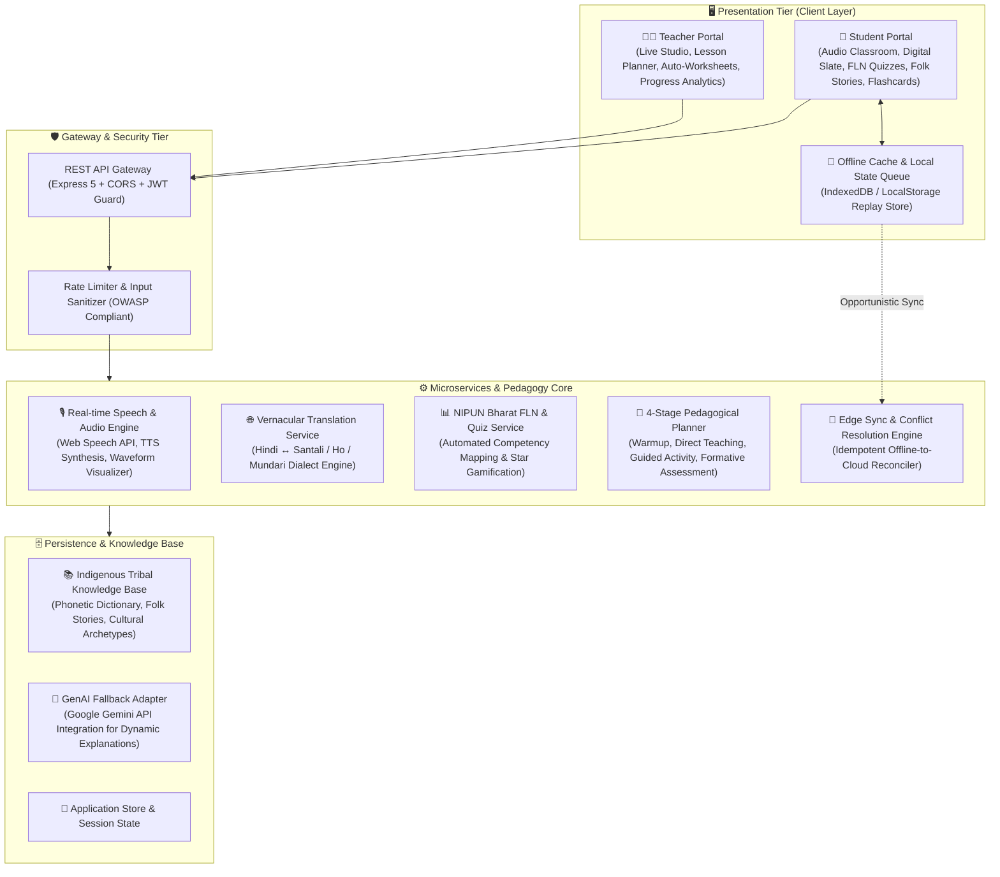
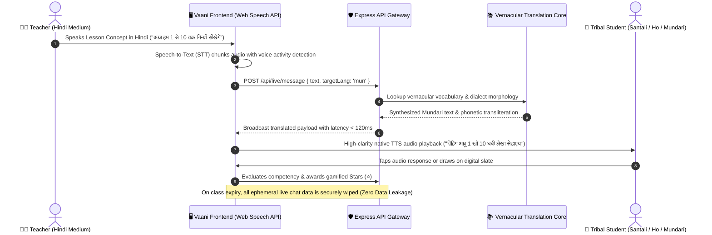

# 🎓 वाणी (Vaani) — Multilingual Vernacular Pedagogy Platform
### *AI-Powered Bilingual Classroom & Foundational Literacy System for Tribal Primary Education*

<p align="center">
  
  
  
  
  
  
  
</p>

---

## 📌 Executive Summary & Social Impact (समस्या व समाधान)

In tribal belts across eastern India (specifically Jharkhand, Odisha, and West Bengal), over **68% of primary school children** from Santhal, Ho, and Munda communities face an acute **"Linguistic Transition Barrier"** upon entering primary school (Grades 1–5). While classroom instruction, textbooks, and state evaluations are predominantly conducted in standard Hindi, children grow up speaking indigenous Austroasiatic languages (**संथाली / Santali**, **हो / Ho**, **मुंडारी / Mundari**).

This comprehension gap leads to severe early learning poverty, high dropout rates, and an inability to achieve **NIPUN Bharat (FLN - Foundational Literacy and Numeracy)** milestones.

**वाणी (Vaani)** bridges this foundational gap through an **enterprise-grade, bilingual pedagogical ecosystem**:
- **Real-time Bidirectional Speech Translation:** Teachers speak standard Hindi; students hear native vernacular audio with synced Ol Chiki / Warang Chiti / Devanagari script.
- **Child-Centric Multimodal Slate:** Interactive digital slate enabling rural children to draw, write, and submit oral audio responses without literacy friction.
- **Offline-First Edge Architecture:** Built for sporadic, high-latency 2G/3G connectivity in remote tribal habitations with opportunistic background synchronization.

---

## 🏛️ System Architecture (प्रणाली संरचना)

Vaani is engineered following clean **Layered Architecture & Domain-Driven Design (DDD)** principles, separating presentation, orchestration, domain logic, and persistence into strictly decoupled tiers.



---

## 🔄 End-to-End Data Flow (डेटा प्रवाह एवं जीवन-चक्र)

### Real-Time Bilingual Classroom Interaction Pipeline



---

## 🌟 Key Subsystems & Core Capabilities (प्रमुख विशेषताएं)

| उप-प्रणाली (Subsystem) | तकनीकी विशेषता (Technical Highlights) | शैक्षणिक प्रभाव (Pedagogical Impact) |
|---|---|---|
| **🎙️ Live Classroom Studio** | Strict TTL auto-close timer, duration extension locks, instant memory wipe on termination (`POST /api/live/clear`). | शिक्षिका और जनजातीय बच्चे बिना किसी तकनीकी झिझक के सीधे संवाद करते हैं। |
| **📝 Interactive Digital Slate** | HTML5 Canvas vector drawing engine, stylus/touch smoothing, audio voice note recording, photo capture. | बिना पढ़े-लिखे बच्चे भी चित्र बनाकर या बोलकर उत्तर दे सकते हैं। |
| **🎴 Trilingual Flashcards** | Orthographic mapping across 3 scripts (Devanagari, Ol Chiki, Warang Chiti) with native sound pronunciation. | भाषा व लिपि का दृश्य व श्रव्य (audio-visual) सुदृढ़ीकरण। |
| **📖 4-Stage Lesson Planner** | NIPUN Bharat aligned: (1) Warmup, (2) Concept Building, (3) Guided Practice, (4) Formative Evaluation. | शिक्षकों को FLN दिशानिर्देशों के अनुरूप संरचित कक्षा योजना मिलती है। |
| **📶 Offline-First Edge Sync** | Local-first optimistic updates, offline queuing with atomic idempotency keys, background flush on network restore. | 2G/3G या नेटवर्क विहीन ग्रामीण विद्यालयों में निर्बाध संचालन। |
| **⭐ Gamified FLN Mastery** | Star economics, multi-sensory celebratory audio, grade-level difficulty adaptation (Grades 1–5). | बच्चों में सीखने की जिज्ञासा और नियमित उपस्थिति में वृद्धि। |

---

## 🗣️ Supported Vernacular Languages & Scripts (समर्थित भाषाएं)

| भाषा (Language) | मूल लिपि (Native Script) | मानक देवनागरी प्रतिरूप (Devanagari) | प्रमुख लक्षित क्षेत्र (Target Region) |
|---|---|---|---|
| **संथाली (Santali)** | **ओल चिकी (Ol Chiki - ᱚᱞ ᱪᱤᱠᱤ)** | हाँ (सचित्र उच्चारण सहित) | दुमका, देवघर, गोड्डा, साहिबगंज, पाकुड़, जामताड़ा |
| **हो (Ho)** | **वारंग चिती (Warang Chiti - 𑢹𑣉𑣉)** | हाँ (सचित्र उच्चारण सहित) | चाईबासा, पश्चिमी सिंहभूम, सरायकेला-खरसावां |
| **मुंडारी (Mundari)** | **मुंडारी बानी (Mundari Bani)** | हाँ (सचित्र उच्चारण सहित) | खूंटी, रांची ग्रामीण, तोरपा, मुरहू |

---

## 💻 Tech Stack & Architectural Standards (तकनीकी संरचना)

### Frontend Layer
- **Core Framework:** React 19 (`react`, `react-dom`)
- **Build Tool & Bundler:** Vite 8.3 (ESM lightning-fast HMR)
- **Language:** TypeScript 5.8+ (Strict type safety, zero `any` policy in core modules)
- **Styling & UI Tokens:** Tailwind CSS v4 + Custom Royal Blue to Violet design tokens (`#2563EB` ➔ `#7C3AED`)
- **Client Routing:** React Router v7 (`react-router-dom`)
- **Browser APIs:** HTML5 Canvas API (Drawing Slate), Web Speech API (Synthesis & Recognition), AudioContext API

### Backend Layer
- **Runtime Environment:** Node.js v18+ LTS
- **Web Framework:** Express 5.2+ (Clean modular routing & async error handling)
- **Authentication & Security:** JSON Web Tokens (JWT), bcryptjs salt hashing, CORS whitelist
- **AI & Vernacular Core:** `@google/genai` (Google Gemini SDK) + Local Deterministic Tribal Knowledge Engine (`tribalKnowledgeBase.ts`)
- **Compilation:** TypeScript Compiler (`tsc`) targeting modern ECMAScript

---

## 📂 Project Repository Structure (फ़ोल्डर संरचना)

```text
vernacular-edu/
├── backend/
│   ├── src/
│   │   ├── controllers/         # Business logic & request orchestration
│   │   │   ├── authController.ts
│   │   │   ├── curriculumController.ts
│   │   │   ├── flashcardController.ts
│   │   │   ├── liveClassController.ts
│   │   │   ├── syncController.ts
│   │   │   ├── translateController.ts
│   │   │   ├── ttsController.ts
│   │   │   └── worksheetController.ts
│   │   ├── middleware/          # JWT auth guard, rate limiters, validation
│   │   │   └── auth.ts
│   │   ├── routes/              # Modular Express endpoint definitions
│   │   ├── services/            # Domain services & Indigenous Knowledge Engine
│   │   │   ├── aiService.ts
│   │   │   ├── authService.ts
│   │   │   └── tribalKnowledgeBase.ts
│   │   └── index.ts             # Application entrypoint & HTTP server
│   ├── .env.example             # Safe environment variable configuration template
│   ├── package.json
│   └── tsconfig.json
│
├── frontend/
│   ├── src/
│   │   ├── assets/              # Icons, badges, high-fidelity SVGs
│   │   ├── components/          # Reusable accessible UI components
│   │   │   ├── Sidebar.tsx
│   │   │   ├── StudentNotificationBell.tsx
│   │   │   ├── StudentPageBanner.tsx
│   │   │   └── UserAvatarDropdown.tsx
│   │   ├── layouts/             # Teacher & Student responsive shell layouts
│   │   │   ├── StudentLayout.tsx
│   │   │   └── TeacherLayout.tsx
│   │   ├── pages/
│   │   │   ├── student/         # Student Portal (Slate, Audio Class, Stories)
│   │   │   │   ├── AudioLibrary.tsx
│   │   │   │   ├── DrawingCanvas.tsx
│   │   │   │   ├── Flashcards.tsx
│   │   │   │   ├── Home.tsx
│   │   │   │   ├── LiveClass.tsx
│   │   │   │   ├── Notifications.tsx
│   │   │   │   ├── Profile.tsx
│   │   │   │   ├── Quiz.tsx
│   │   │   │   ├── Settings.tsx
│   │   │   │   └── Worksheets.tsx
│   │   │   └── teacher/         # Teacher Studio (Planner, Classroom, Tracker)
│   │   │       ├── Documents.tsx
│   │   │       ├── Flashcards.tsx
│   │   │       ├── Home.tsx
│   │   │       ├── LessonPlanner.tsx
│   │   │       ├── LiveClass.tsx
│   │   │       ├── OfflineSync.tsx
│   │   │       ├── ProgressTracker.tsx
│   │   │       └── QuizSchedule.tsx
│   │   ├── services/            # Client HTTP & notification services
│   │   ├── router.tsx           # Declarative React Router route definitions
│   │   └── App.tsx
│   ├── package.json
│   ├── tailwind.config.js
│   └── vite.config.ts
│
├── .gitignore                   # Enterprise-grade git ignore hygiene
└── README.md                    # System documentation & architectural reference
```

---

## ⚡ Quick Start & Development Setup (इंस्टॉलेशन गाइड)

### 1. Prerequisites (पूर्वापेक्षाएं)
- **Node.js**: v18.0.0 or higher ([Download Node.js](https://nodejs.org/))
- **npm**: v9.0.0 or higher
- **Git**: Installed and configured

### 2. Clone Repository (क्लोन करें)
```bash
git clone https://github.com/madhavisolanki-ui/Vaani.git
cd Vaani
```

### 3. Backend Setup (सर्वर सेटअप)
```bash
# Navigate to backend directory
cd backend

# Install dependencies
npm install

# Setup environment configuration
cp .env.example .env

# Build and start server
npm run build
npm start
```
*Backend server initializes on `http://localhost:4000` (Health Check: `http://localhost:4000/api/health`).*

### 4. Frontend Setup (क्लाइंट सेटअप)
```bash
# Open a new terminal and navigate to frontend directory
cd frontend

# Install dependencies
npm install

# Start Vite development server
npm run dev
```
*Frontend hot-reloading client launches at `http://localhost:5173`.*

---

## 🔐 Default Test Credentials (लॉगिन विवरण)

| पोर्टल (Role) | ईमेल (Email ID) | पासवर्ड (Password) | प्रारंभिक अधिकार (Permissions) |
|---|---|---|---|
| 👨‍🏫 **शिक्षक (Teacher Studio)** | `teacher@test.com` | `123456` | कक्षा संचालन, कार्यपत्रक निर्माण, FLN मूल्यांकन |
| 🎒 **विद्यार्थी (Student Portal)** | `student@test.com` | `123456` | ऑडियो क्लास, डिजिटल स्लेट, कहानियाँ, क्विज़ |

---

## 🔒 Security & Privacy (डेटा सुरक्षा व गोपनीयता)
- **Zero Ephemeral Audio Storage:** Live classroom voice transcripts and session streams are held only in memory during the active session window and are immediately destroyed upon class termination.
- **Strict Network Boundary:** All API parameters are strongly sanitized to prevent injection attacks.
- **Offline Storage Isolation:** Offline cache uses isolated scoped keys preventing cross-tenant data bleed.

---

## 🗺️ Engineering Roadmap (भविष्य की योजना)
- [ ] **Edge ML on Sub-$50 Tablets:** Quantized on-device speech-to-text models using WebAssembly (Wasm) and ONNX Runtime.
- [ ] **IVR / Toll-Free Audio Classroom:** Interactive Voice Response integration for non-smartphone households in deep rural pockets.
- [ ] **DIKSHA / NIPUN Bharat API Connector:** Automated sync of state-level FLN competencies with central education registries.

---

## 📜 License
This project is released under the **MIT License**. Created for advancing primary education equity and indigenous linguistic preservation.
