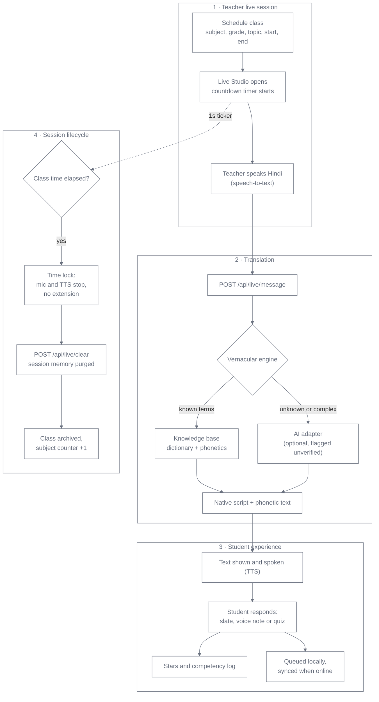
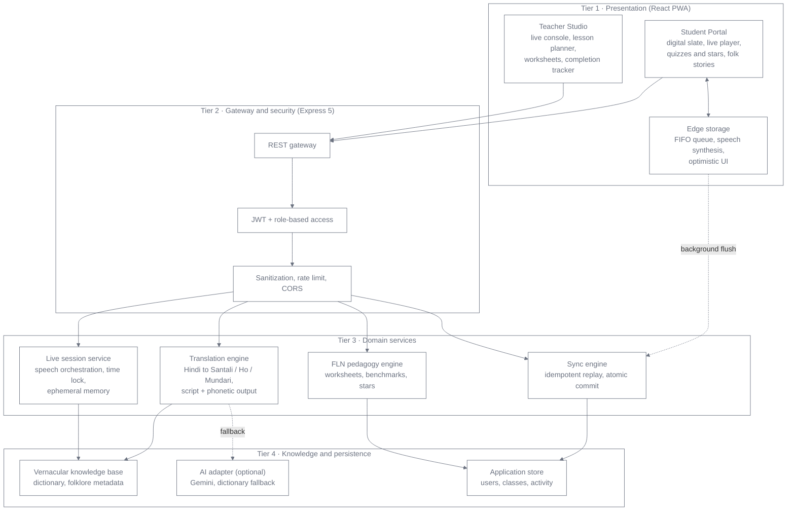

<div align="center">

# 🎓 Vaani (वाणी)

### Multilingual Vernacular Pedagogy Platform
*A bilingual classroom and foundational-literacy system for tribal primary education, Grades 1–5*


**"Language should be a bridge to learning, never a barrier."**

[Why Vaani](#why-vaani) · [Features](#features) · [How it works](#how-it-works) · [Architecture](#architecture) · [Languages](#languages) · [Quick start](#quick-start) · [API](#rest-api) · [Roadmap](#roadmap)

</div>

---

## Why Vaani

Children from **Santhal, Ho and Munda** communities in Jharkhand, Odisha and West Bengal start school speaking **Santali, Ho or Mundari**. Their classrooms, textbooks and exams, however, run almost entirely in Hindi, with little vernacular support. The result is weak foundational literacy and numeracy (FLN), silent classrooms and early dropout.

Vaani is a bilingual bridge, aligned with **NEP 2020** and **NIPUN Bharat**: the teacher teaches in Hindi, and every child sees and hears the lesson in their own language.

> **Note on language data:** vernacular vocabulary must be reviewed by native speakers and local educators before classroom use. Vaani flags words it does not know instead of guessing.

## Features

| | Feature | What it does |
|---|---|---|
| 🎙️ | **Live translation** | Teacher speaks Hindi; students get native-script text, a phonetic guide and spoken audio. |
| ✏️ | **Digital slate (स्लेट)** | Drawing canvas, voice answers and workbook photos, built for young learners. |
| 📖 | **4-stage lesson planner** | Warm-up (5), instruction (15), guided practice (15), assessment (10 min). |
| ⏱️ | **Strict time lock** | A class ends on schedule, cannot be extended, and its session data is wiped. |
| 📶 | **Offline-first sync** | Student work queues locally with a unique key per action, and syncs without duplicates when the network returns. |
| ⭐ | **Stars and quizzes** | Gamified FLN quizzes and worksheets with positive reinforcement. |
| 📚 | **Folklore library** | Audio folk stories in Santali, Ho and Mundari (लोककथाएँ). |
| 📊 | **Teacher dashboard** | Active classes up front; completed classes archived, with subject-wise counters. |

## How it works



## Architecture

Layered, hexagonal-style design: presentation, gateway, domain services and data are decoupled.



## Languages

| Language | Display script | Regions |
|---|---|---|
| **Santali (संथाली)** | Ol Chiki (ᱥᱟᱱᱛᱟᱲᱤ) + phonetic guide | Dumka, Deoghar, Godda, Sahibganj, Pakur, Jamtara |
| **Ho (हो)** | Devanagari + phonetic guide (Warang Citi planned) | West Singhbhum, Seraikela-Kharsawan |
| **Mundari (मुंडारी)** | Devanagari + phonetic guide (Mundari Bani planned) | Khunti, Ranchi (rural), Torpa, Murhu |

## Tech stack

| Layer | Technology |
|---|---|
| Frontend | React 19, Vite, React Router 7, Tailwind CSS v4 |
| Browser APIs | Web Speech (recognition and synthesis), Canvas, MediaRecorder |
| Backend | Node.js 18+, Express 5, TypeScript (strict) |
| Security | JWT, bcryptjs, rate limiting, input sanitization, CORS |
| AI (optional) | `@google/genai` (Gemini) fallback, with a deterministic dictionary path |

## Quick start

Requires **Node.js 18+**, **npm 9+** and **Git**.

```bash
git clone https://github.com/madhavisolanki-ui/Vaani.git
cd Vaani
```

**Backend** runs at `http://localhost:4000` (health check: `/api/health`):

```bash
cd backend
npm install
cp .env.example .env     # set JWT_SECRET and, optionally, your Gemini key
npm run build && npm start
```

**Frontend** runs at `http://localhost:5173`, in a second terminal:

```bash
cd frontend
npm install
npm run dev
```

**Demo accounts** (development only, remove before deploying):

| Role | Email | Password |
|---|---|---|
| Teacher | `teacher@test.com` | `123456` |
| Student | `student@test.com` | `123456` |

**Try it:** sign in as the teacher, schedule a short class and send a Hindi sentence. In a second browser window, sign in as the student to see and hear it in the chosen language.

## REST API

All endpoints except login and register need `Authorization: Bearer <token>`.

<details>
<summary><b>Auth, Live, Curriculum and Sync endpoints</b></summary>

| Method | Endpoint | Purpose |
|---|---|---|
| POST | `/api/auth/login` | Sign in, returns `{ token, user }` |
| POST | `/api/auth/register` | Create a role-scoped account |
| GET | `/api/auth/me` | Current user profile |
| POST | `/api/live/message` | Translate Hindi text to the target language (`{ text, targetLang }`) |
| GET | `/api/live/session` | Room status, remaining seconds, schedule, messages |
| POST | `/api/live/clear` | Purge session buffers when a class ends |
| GET | `/api/curriculum/classes` | List scheduled and active classes |
| POST | `/api/curriculum/classes` | Schedule a class (`subject, grade, topic, startTime, endTime`) |
| GET | `/api/curriculum/notes` | 4-stage lesson blueprint (`classId`) |
| GET | `/api/curriculum/practice-papers` | Bilingual FLN worksheets (`grade`) |
| POST | `/api/sync/flush` | Reconcile queued offline actions (`{ operations: [{ id, action, payload }] }`) |
| GET | `/api/sync/status` | Sync status and last sync time |
</details>

<details>
<summary><b>Project structure</b></summary>

```text
vernacular-edu/
├── backend/                               Express 5 + TypeScript API
│   ├── src/
│   │   ├── controllers/
│   │   │   ├── authController.ts          login, register, JWT
│   │   │   ├── curriculumController.ts    class scheduling, lesson plans
│   │   │   ├── flashcardController.ts     bilingual flashcards
│   │   │   ├── liveClassController.ts     live room, broadcast, time lock
│   │   │   ├── syncController.ts          offline sync reconciler
│   │   │   ├── translateController.ts     dialect lookup
│   │   │   ├── ttsController.ts           speech synthesis
│   │   │   └── worksheetController.ts     FLN worksheets
│   │   ├── middleware/
│   │   │   └── auth.ts                    JWT guard, rate limiter
│   │   ├── routes/                        route declarations
│   │   ├── services/
│   │   │   ├── aiService.ts               Gemini integration
│   │   │   ├── authService.ts             hashing, user auth
│   │   │   └── tribalKnowledgeBase.ts     vernacular dictionary, folklore
│   │   └── index.ts                       app bootstrap
│   └── .env.example
│
├── frontend/                              React 19 + Vite
│   └── src/
│       ├── components/                    Sidebar, notification bell, banners, avatar menu
│       ├── layouts/                       StudentLayout, TeacherLayout
│       ├── pages/
│       │   ├── student/                   AudioLibrary, DrawingCanvas, Flashcards, Home,
│       │   │                              LiveClass, Profile, Quiz, Settings, Worksheets
│       │   └── teacher/                   Documents, Flashcards, Home, LessonPlanner,
│       │                                  LiveClass, OfflineSync, ProgressTracker, QuizSchedule
│       ├── router.tsx
│       └── App.tsx
│
└── README.md
```
</details>

## Privacy and child safety

- **Ephemeral live data:** transcripts and translation payloads stay in server memory and are wiped when a class ends.
- **Minimal data:** no biometric data is collected; personal data is limited to what educators authorize.
- **Per-user local storage:** keys are namespaced to prevent cross-profile leakage on shared tablets.
- **Before school deployment:** a formal review under India's Digital Personal Data Protection Act, 2023 (including its rules on children's data) is still required.

## Roadmap

- [x] Live Hindi → Santali / Ho / Mundari translation pipeline
- [x] Digital slate, strict timer locks and ephemeral session memory
- [x] 4-stage lesson planner and subject-wise completion counters
- [ ] On-device speech recognition (Wasm + ONNX Runtime) for low-cost tablets
- [ ] IVR / toll-free audio classroom for homes without smartphones
- [ ] DIKSHA / NIPUN Bharat connector
- [ ] Community-verified vernacular dictionary with native-speaker educators

## Contributing

Contributions are welcome, especially from native Santali, Ho and Mundari speakers and primary-school educators. Please open an issue to discuss a change before sending a pull request.

## License

Released under the **MIT License**. See [`LICENSE`](LICENSE).

<div align="center"><sub>Built with respect for the languages, heritage and children of Jharkhand, India.</sub></div>
