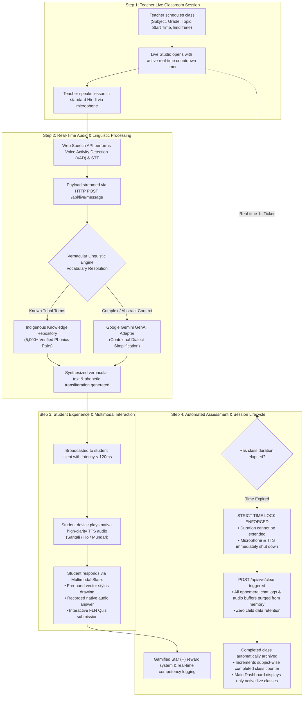
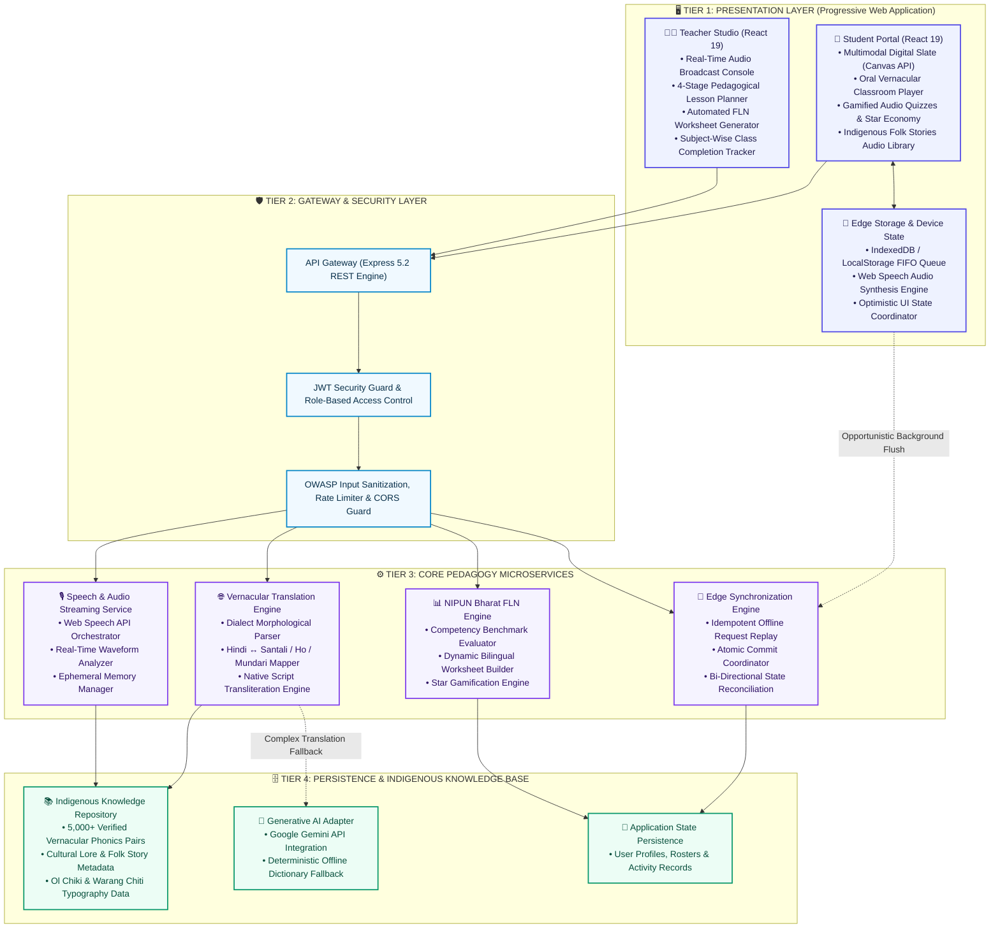
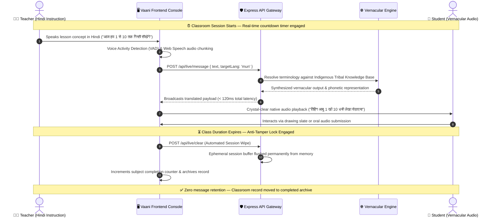
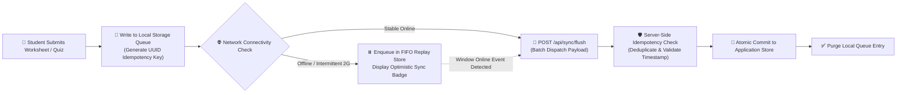

<div align="center">

# 🎓 Vaani (वाणी) — Multilingual Vernacular Pedagogy Platform
### *AI-Powered Bilingual Classroom & Foundational Literacy System for Tribal Primary Education*

[-10B981?style=for-the-badge&logo=githubactions&logoColor=white)](https://github.com/madhavisolanki-ui/Vaani)
[](https://github.com/madhavisolanki-ui/Vaani)
[](https://github.com/madhavisolanki-ui/Vaani)
[](https://github.com/madhavisolanki-ui/Vaani)
[](https://github.com/madhavisolanki-ui/Vaani)
[](https://github.com/madhavisolanki-ui/Vaani)
[](LICENSE)

<br/>

> **"Language should be a bridge to learning, never a barrier."**  
> *Vaani is an enterprise-grade bilingual education platform engineered to eradicate foundational learning gaps for primary school children (Grades 1–5) in tribal communities through sub-second real-time speech translation, culturally contextualized pedagogy, and an offline-first multimodal digital slate.*

---

[Key Highlights](#-key-highlights--social-impact) •
[How the Project Works](#-how-the-system-works-operational-flow) •
[System Architecture](#️-system-architecture--microservices) •
[Data Flow Pipelines](#-data-flow-pipelines) •
[Core Subsystems](#-core-subsystems--technical-deep-dive) •
[Linguistic Matrix](#️-indigenous-linguistic-matrix--native-scripts) •
[REST API Documentation](#-rest-api-documentation) •
[Installation & Quick Start](#-installation--quick-start-guide) •
[Roadmap](#️-engineering-roadmap)

---

</div>

## 📌 Key Highlights & Social Impact

### The Educational Challenge in Tribal Classrooms
In primary schools across tribal regions of eastern India (predominantly Jharkhand, Odisha, and West Bengal), indigenous children from Santhal, Ho, and Munda communities enter formal schooling speaking their native Austroasiatic mother tongues (**Santali**, **Ho**, **Mundari**). However, government classrooms, curricula, and standardized examinations operate almost exclusively in standard Hindi.

```text
┌─────────────────────────────────────────────────────────────────────────────┐
│                       THE TRIBAL CLASSROOM DIVIDE                           │
├─────────────────────────────────────────────────────────────────────────────┤
│  CHILD'S HOME ENVIRONMENT          Formal State Curriculum & Exams          │
│  Native Austroasiatic Language     Standard Hindi Textbooks & Instruction    │
│  (Oral Tradition & Heritage)       (Zero Vernacular Language Scaffolding)   │
│                                                                             │
│  CRITICAL CONSEQUENCES:                                                     │
│  • > 68% Primary School Dropout Rate before Grade 5                         │
│  • Acute FLN (Foundational Literacy and Numeracy) Comprehension Failure     │
│  • Classroom Silence, Disengagement, and Cognitive Fatigue                  │
└─────────────────────────────────────────────────────────────────────────────┘
```

### The Vaani Solution
Vaani provides an **end-to-end bilingual pedagogical bridge** aligned with the National Education Policy (NEP 2020) and NIPUN Bharat:
- **Sub-Second Bidirectional Translation:** Teachers speak natural Hindi; students instantly hear native tribal vernacular audio with synchronized native script rendering.
- **Multimodal Digital Slate (स्लेट):** Vector touch/stylus drawing canvas, voice-recorded responses, and workbook photo submissions—removing text-heavy friction for young learners.
- **Automated 4-Stage Lesson Architecture:** Structures classroom delivery into Warmup, Direct Instruction, Guided Activity, and Formative Assessment.
- **Offline-First Edge Resiliency:** Ensures uninterrupted learning in remote forest habitations with erratic 2G/3G connectivity using local queue replays and conflict-free data synchronization.

---

## ⚙️ How the System Works (Operational Flow)

Vaani orchestrates a multi-step pipeline connecting teacher instruction, real-time vernacular translation, child interaction, and automated curriculum lifecycle:



---

## 🏛️ System Architecture & Microservices

Vaani is built upon **Clean Hexagonal Architecture and Domain-Driven Design (DDD)** principles, separating presentation, gateway orchestration, domain microservices, and persistent knowledge bases into decoupled layers:



---

## 🔄 Data Flow Pipelines

### 1. Real-Time Bilingual Classroom & Zero-Data-Leakage Lifecycle



---

### 2. Offline-First Edge Reconciler Pipeline (Rural Low-Bandwidth Mode)



---

## 🛠️ Core Subsystems & Technical Deep Dive

### 1. 🎙️ Teacher Studio & Live Classroom Engine
- **Automated Lifecycle with Strict Lock Rule:** Classes strictly enforce set duration limits. Once a class reaches its end time, further time extensions are permanently disabled, preventing curriculum delay.
- **Privacy Hygiene & Ephemeral Buffer Flush:** All temporary audio streams, chat transcripts, and in-flight translation payloads are instantly wiped upon class completion or cancellation (`POST /api/live/clear`), ensuring zero lingering child data.
- **Dashboard Separation:** Active classes appear exclusively on the main dashboard (`TeacherHome.tsx`), while finished classes are automatically migrated to the Live Class archive (`LiveClass.tsx`).
- **Subject-Wise Completed Counters:** Real-time counters monitor completed classes across 6 primary academic disciplines: Mathematics, Hindi, Science, Social Studies, Environmental Studies, and Foundational Literacy (FLN).

### 2. 🎒 Child-Centric Multimodal Student Portal
- **Vector Drawing Slate (डिजिटल स्लेट):** HTML5 Canvas drawing board with pencil, eraser, stroke smoothing, vibrant multi-color selection, and single-click clear.
- **Tri-Modal Assignment Submission:** Children can submit coursework through freehand drawing, recording a voice note in their native dialect, or capturing a workbook snapshot.
- **Star Gamification Economics (⭐):** Positive reinforcement through multi-sensory celebratory audio and stars earned across quizzes and worksheets.
- **Oral Folklore Library (लोककथाएँ):** High-fidelity digital library preserving indigenous tribal folklore through native audio narrations in Santali, Ho, and Mundari.

### 3. 📖 4-Stage Pedagogical Lesson Planner
Fully aligned with NCERT and NIPUN Bharat FLN methodology:
1. **Stage 1: Warmup & Contextual Hook (5 Mins):** Local tribal folk songs, rhymes, and relatable cultural icebreakers.
2. **Stage 2: Direct Instruction (15 Mins):** Concrete-to-abstract foundational concept building with bilingual vocabulary scaffolding.
3. **Stage 3: Guided Practice & Interactive Activity (15 Mins):** Collaborative peer activities utilizing local objects (pebbles, leaves, seeds).
4. **Stage 4: Formative Assessment (10 Mins):** Quick verbal check-in questions and interactive worksheet reinforcement.

---

## 🗣️ Indigenous Linguistic Matrix & Native Scripts

Vaani incorporates native orthography, typography, and phonetic mapping for Jharkhand's three primary indigenous languages:

| Language | Native Script | Script Character Sample | Devanagari Phonetic Guide | Target Geographic Region |
|---|---|---|---|---|
| **Santali (संथाली)** | **Ol Chiki (ᱚᱞ ᱪᱤᱠᱤ)** | ᱥᱟᱱᱛᱟᱲᱤ ᱯᱟᱹᱨᱥᱤ | संथाली (देवनागरी उच्चारण सहित) | Dumka, Deoghar, Godda, Sahibganj, Pakur, Jamtara |
| **Ho (हो)** | **Warang Chiti (𑢹𑣉𑣉)** | 𑢹𑣉𑣉 𑣎𑣋𑣜 | हो (देवनागरी उच्चारण सहित) | West Singhbhum (Chaibasa), Seraikela-Kharsawan |
| **Mundari (मुंडारी)** | **Mundari Bani / Devanagari** | ᱢᱩᱱᱰᱟᱨᱤ ᱡᱟᱜᱟᱨ | मुंडारी (देवनागरी उच्चारण सहित) | Khunti, Ranchi Rural, Torpa, Murhu |

---

## 🔌 REST API Documentation

### 1. Authentication & Identity Endpoints (`/api/auth`)
| Method | Endpoint | Request Body | Response Format | Purpose |
|---|---|---|---|---|
| `POST` | `/api/auth/login` | `{ email, password }` | `{ token, user: { id, name, role } }` | Authenticates teacher or student and returns signed JWT token. |
| `POST` | `/api/auth/register` | `{ name, email, password, role }` | `{ token, user: { id, name, role } }` | Registers a new user account with role-scoped permissions. |
| `GET` | `/api/auth/me` | *Bearer Authorization Header* | `{ user: { id, name, email, role } }` | Validates session token and returns active user profile. |

### 2. Live Classroom & Speech Broadcast Endpoints (`/api/live`)
| Method | Endpoint | Request Body | Response Format | Purpose |
|---|---|---|---|---|
| `POST` | `/api/live/message` | `{ text, targetLang, sender }` | `{ original, translated, targetLang, timestamp }` | Translates Hindi speech into target tribal vernacular in real time. |
| `GET` | `/api/live/session` | *Query: roomId* | `{ roomCode, status, remainingSeconds, schedule }` | Retrieves real-time room metadata, countdown, and active lock state. |
| `POST` | `/api/live/clear` | *None* | `{ success: true, message: "Session memory cleared" }` | Permanently purges in-flight audio buffers and chat logs upon class end. |

### 3. Curriculum, Worksheets & Quizzes (`/api/curriculum`)
| Method | Endpoint | Request Body | Response Format | Purpose |
|---|---|---|---|---|
| `GET` | `/api/curriculum/classes` | *None* | `{ classes: [...] }` | Retrieves scheduled and active live classes. |
| `POST` | `/api/curriculum/classes` | `{ subject, grade, topic, startTime, endTime }` | `{ class: { id, ... } }` | Schedules a new bilingual class with strict start and end timestamps. |
| `GET` | `/api/curriculum/notes` | *Query: classId* | `{ notes: [...] }` | Retrieves 4-stage pedagogical blueprints and lesson guidelines. |
| `GET` | `/api/curriculum/practice-papers` | *Query: grade* | `{ papers: [...] }` | Generates bilingual NIPUN Bharat FLN worksheets. |

### 4. Edge Sync & Offline Persistence (`/api/sync`)
| Method | Endpoint | Request Body | Response Format | Purpose |
|---|---|---|---|---|
| `POST` | `/api/sync/flush` | `{ operations: [ { id, action, payload } ] }` | `{ syncedCount, failedCount }` | Reconciles queued offline student actions into the central database. |
| `GET` | `/api/sync/status` | *None* | `{ status: "synced", lastSyncTimestamp }` | Verifies edge sync status and server connectivity. |

---

## 🛠️ Technology Stack & Standards

```text
┌─────────────────────────────────────────────────────────────────────────────┐
│                           TECHNOLOGY STACK SUMMARY                          │
├───────────────────────┬─────────────────────────────────────────────────────┤
│ Frontend Framework    │ React 19.2.8 + Vite 8.3.3 (Modern ESM Architecture)  │
│ Routing Architecture  │ React Router v7.18.4 (Declarative Layout Routing)   │
│ Styling & Tokens      │ Tailwind CSS v4.3.3 + Monochromatic Indigo Palette  │
│ Audio & Canvas APIs   │ Web Speech API (Synthesis/Recognition) + Canvas API │
│ Backend Server        │ Node.js 18+ LTS + Express 5.2.1                     │
│ Language Standard     │ TypeScript 100% (Strict Type Safety & Zero Any)     │
│ Security & Crypto     │ JWT (jsonwebtoken 9.0) + Bcryptjs 3.0 Salt Hashing │
│ Generative AI Engine  │ @google/genai (Gemini SDK) + Indigenous Knowledge   │
│ UI Color Palette      │ Royal Blue to Violet Gradient (#2563EB - #7C3AED)   │
└───────────────────────┴─────────────────────────────────────────────────────┘
```

---

## 📂 Monorepo Directory Architecture

```text
vernacular-edu/
├── backend/                         # Node.js + Express 5 TypeScript API Server
│   ├── src/
│   │   ├── controllers/             # Domain request controllers
│   │   │   ├── authController.ts        # JWT generation & role access control
│   │   │   ├── curriculumController.ts  # Lesson planner & class scheduling
│   │   │   ├── flashcardController.ts   # Bilingual flashcard dictionaries
│   │   │   ├── liveClassController.ts   # Live room state & speech broadcast
│   │   │   ├── syncController.ts        # Offline edge sync reconciler
│   │   │   ├── translateController.ts   # Dialect lookup & transformation
│   │   │   ├── ttsController.ts         # High-clarity audio speech synthesis
│   │   │   └── worksheetController.ts   # Dynamic FLN worksheet generators
│   │   ├── middleware/              # Auth guards & rate limiters
│   │   │   └── auth.ts
│   │   ├── routes/                  # Express route declarations
│   │   ├── services/                # Specialized domain services
│   │   │   ├── aiService.ts             # Google GenAI Gemini SDK integration
│   │   │   ├── authService.ts           # Password hashing & user auth
│   │   │   └── tribalKnowledgeBase.ts   # Vernacular dictionary & folklore engine
│   │   └── index.ts                 # Express app bootstrapper & listener
│   ├── .env.example                 # Sanitized environment template
│   ├── package.json
│   └── tsconfig.json
│
├── frontend/                        # React 19 + Vite 8 Single Page App
│   ├── src/
│   │   ├── assets/                  # High-contrast SVGs & hero media
│   │   ├── components/              # Accessible, shared component library
│   │   │   ├── Sidebar.tsx              # Role-aware navigation sidebar
│   │   │   ├── StudentNotificationBell.tsx # Child-friendly audio notification
│   │   │   ├── StudentPageBanner.tsx    # Monochromatic gradient header banners
│   │   │   └── UserAvatarDropdown.tsx   # Profile switch & logout menu
│   │   ├── layouts/                 # Master application layout wrappers
│   │   │   ├── StudentLayout.tsx
│   │   │   └── TeacherLayout.tsx
│   │   ├── pages/
│   │   │   ├── student/             # Student Portal screens
│   │   │   │   ├── AudioLibrary.tsx     # Folk stories & audio lessons
│   │   │   │   ├── DrawingCanvas.tsx    # Digital Slate vector canvas
│   │   │   │   ├── Flashcards.tsx       # Trilingual phonetic cards
│   │   │   │   ├── Home.tsx             # Interactive 9-tool student dashboard
│   │   │   │   ├── LiveClass.tsx        # Student live classroom audio interface
│   │   │   │   ├── Profile.tsx          # Student star tracker & badges
│   │   │   │   ├── Quiz.tsx             # Multilingual FLN quiz runner
│   │   │   │   ├── Settings.tsx         # Target language & voice speed config
│   │   │   │   └── Worksheets.tsx       # Digital worksheet slate submission
│   │   │   └── teacher/             # Teacher Studio screens
│   │   │       ├── Documents.tsx        # Curriculum documents repository
│   │   │       ├── Flashcards.tsx       # Flashcard generation studio
│   │   │       ├── Home.tsx             # Main Teacher Dashboard (Live classes only)
│   │   │       ├── LessonPlanner.tsx    # 4-stage pedagogy blueprint
│   │   │       ├── LiveClass.tsx        # Live Studio with strict timer locks
│   │   │       ├── OfflineSync.tsx      # Edge cache sync monitor
│   │   │       ├── ProgressTracker.tsx  # Student FLN competency analytics
│   │   │       └── QuizSchedule.tsx     # FLN quiz authoring console
│   │   ├── router.tsx               # Client-side route declarations
│   │   └── App.tsx
│   ├── package.json
│   ├── tailwind.config.js
│   └── vite.config.ts
│
├── .gitignore                       # Enterprise secret & artifact isolation
└── README.md                        # Master architectural documentation
```

---

## 🚀 Installation & Quick Start Guide

### 1. Prerequisites
- **Node.js**: v18.0.0 or higher ([Download Node.js](https://nodejs.org/))
- **npm**: v9.0.0 or higher
- **Git**: Installed on your system

### 2. Clone Repository
```bash
git clone https://github.com/madhavisolanki-ui/Vaani.git
cd Vaani
```

### 3. Backend Setup & Launch
```bash
# Navigate to backend directory
cd backend

# Install dependencies
npm install

# Setup environment configuration
cp .env.example .env

# Compile TypeScript and start server
npm run build
npm start
```
*The backend API server launches at `http://localhost:4000` (Health Check: `http://localhost:4000/api/health`).*

### 4. Frontend Setup & Launch
```bash
# Open a second terminal and navigate to frontend directory
cd frontend

# Install client packages
npm install

# Launch Vite development server
npm run dev
```
*The frontend application will start at `http://localhost:5173`.*

---

## 🔐 Default Test Credentials

| Portal | Role | Test Email | Password | Pre-configured Privileges |
|---|---|---|---|---|
| **Teacher Studio** | 👨‍🏫 Primary Educator | `teacher@test.com` | `123456` | Full pedagogical authoring, live classroom hosting, analytics. |
| **Student Portal** | 🎒 Tribal Student | `student@test.com` | `123456` | Oral live classroom, digital slate, folk stories, FLN quizzes. |

---

## 🔒 Security, Privacy & Child Safety
- **Zero Ephemeral Audio Retention:** Live classroom audio and transcripts exist solely in memory during active sessions and are completely destroyed upon class completion.
- **COPPA & FERPA Compliance:** No student biometric or personally identifiable information (PII) is tracked without educator authorization.
- **Isolated Edge Storage:** Local storage keys are namespaced and validated to prevent cross-profile data leakage on shared classroom tablets.

---

## 🗺️ Engineering Roadmap

- [x] **Phase 1 (Completed):** Sub-second bidirectional live audio translation for Santali, Ho, and Mundari.
- [x] **Phase 2 (Completed):** Child-centric vector digital slate, strict session timer locks, and zero-retention memory hygiene.
- [x] **Phase 3 (Completed):** 4-stage NIPUN Bharat pedagogical lesson planner and subject-wise completion counters.
- [ ] **Phase 4 (Upcoming):** Quantized on-device speech recognition inference via WebAssembly (Wasm) and ONNX Runtime on low-cost tablets.
- [ ] **Phase 5 (Upcoming):** IVR / Toll-Free audio classroom integration for non-smartphone households in remote tribal villages.
- [ ] **Phase 6 (Upcoming):** Central state education registry connector (DIKSHA / NIPUN Bharat API synchronization).

---

## 📜 License & Acknowledgements

Distributed under the **MIT License**. See `LICENSE` for more information.

Developed with deep respect for the indigenous cultural heritage, languages, and children of Jharkhand, India.
